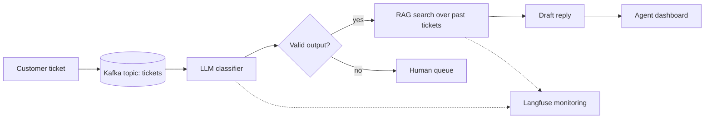
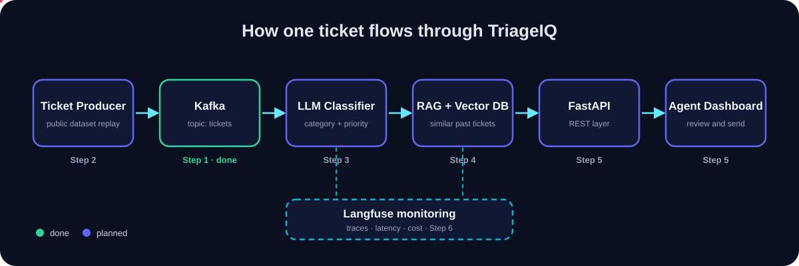

<p align="center">
  
</p>

<p align="center">
  
  
  
  
  
</p>

# TriageIQ

**TriageIQ is a real-time system that reads incoming customer support tickets, decides how urgent they are, routes them to the right team, and drafts a reply using the company's past resolved tickets, so human agents only review and send.**

> Built as a portfolio project using the same kind of stack real companies run: streaming (Kafka), LLMs with retrieval (RAG), APIs (FastAPI), containers (Docker) and LLM monitoring (Langfuse).

---

## The problem

Support teams at companies like banks, delivery apps and SaaS products receive thousands of messages every hour, for example:

> *"I was charged twice for my subscription and I need a refund today!!"*

A human has to read each one, work out the category, urgency and team, and then write a reply. This is slow and expensive, and urgent tickets get buried in the queue.

**TriageIQ does the first 80% of that work automatically, in seconds.**

---

## What is a ticket?

A **ticket** is one customer problem, recorded and tracked by a company's support software (Zendesk, Freshdesk, Zoho Desk and similar).

| Field | Example |
|---|---|
| Ticket ID | `TKT-10482` |
| Message | "I was charged twice for my subscription, need a refund today!!" |
| Channel | Email, chat or app |
| Status | Open, In progress, Closed |

TriageIQ adds three things to every ticket: **category, priority and a suggested reply**.

---

## Process flow



<p align="center">
  
</p>

### Step by step, what happens to one ticket

1. **Ticket arrives.** A producer script replays tickets from a public dataset, acting like a live customer stream.
2. **Kafka holds it.** Kafka is a conveyor belt: if 10,000 tickets arrive at once they wait in line instead of crashing the system.
3. **LLM classifies it.** The model returns structured output: category, priority and customer mood (for example `Billing | High | Angry`).
4. **RAG finds similar past tickets.** A vector database searches by meaning, so "charged twice" matches "duplicate payment".
5. **LLM drafts a reply** grounded in those real past answers, not invented.
6. **Agent dashboard** shows the ticket, priority, routing and suggested reply. The agent edits or approves.
7. **Safe failure.** If the LLM fails or returns invalid output, the ticket goes to a human queue instead of getting lost.
8. **Langfuse records every LLM call** (input, output, latency, cost) so quality can be measured.

---

## Tech stack

| Tool | Role in TriageIQ |
|---|---|
| Apache Kafka | Streams tickets between services |
| LLM (classifier + reply drafting) | Category, priority, mood, suggested reply |
| Vector DB (Qdrant or pgvector) | Semantic search over past resolved tickets |
| LangChain or LlamaIndex | RAG pipeline |
| FastAPI | API layer for the dashboard |
| Docker / Docker Compose | One-command startup |
| Langfuse | LLM tracing, evaluation and cost tracking |
| GitHub Actions | CI: automatic tests on every push |

---

## Roadmap

- [x] **Step 1:** Kafka running in Docker, test ticket sent and received
- [ ] **Step 2:** Python producer that streams realistic fake tickets into Kafka
- [ ] **Step 3:** LLM classifier (category, priority, mood) with safe fallback
- [ ] **Step 4:** Vector DB + RAG over past resolved tickets, suggested replies
- [ ] **Step 5:** FastAPI layer and agent dashboard
- [ ] **Step 6:** Langfuse monitoring and accuracy evaluation on a labeled set
- [ ] **Step 7:** CI/CD with GitHub Actions, final README with measured results

Results (accuracy, latency, cost per ticket) will be added here once Steps 3 to 6 are done.

---

## Quick start (current state: Step 1)

**Requirements:** Docker Desktop running.

```bash
# start Kafka
docker compose up -d

# create the tickets topic
docker exec kafka /opt/kafka/bin/kafka-topics.sh --create --topic tickets --bootstrap-server localhost:9092
```

Expected output: `Created topic tickets.`

Send and read a test ticket (two terminals):

```bash
# Terminal A: consumer
docker exec -it kafka /opt/kafka/bin/kafka-console-consumer.sh --topic tickets --bootstrap-server localhost:9092 --from-beginning

# Terminal B: producer (type a message and press Enter)
docker exec -it kafka /opt/kafka/bin/kafka-console-producer.sh --topic tickets --bootstrap-server localhost:9092
```

---

## Project structure

```
TriageIQ/
├── docker-compose.yml   # Kafka (more services added step by step)
├── README.md
├── banner.svg           # animated header
├── logo.svg             # app icon
├── architecture.svg     # animated flow diagram
└── .gitignore
```

---

## Author

**Hemashree V I**, B.Tech CSE (Cyber Physical Systems), VIT Chennai
