<p align="center">
  
</p>

<p align="center">
       
</p>


## 📸 Screenshots

From the console in demo mode (`python dashboard/server.py --demo`). **Demo tickets and AI results are simulated**: nothing is emailed, and the numbers are not real model accuracy.

| | |
|---|---|
| 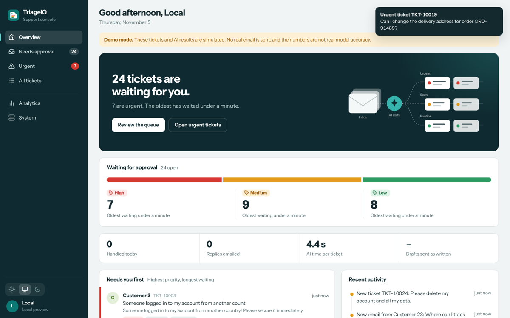 | 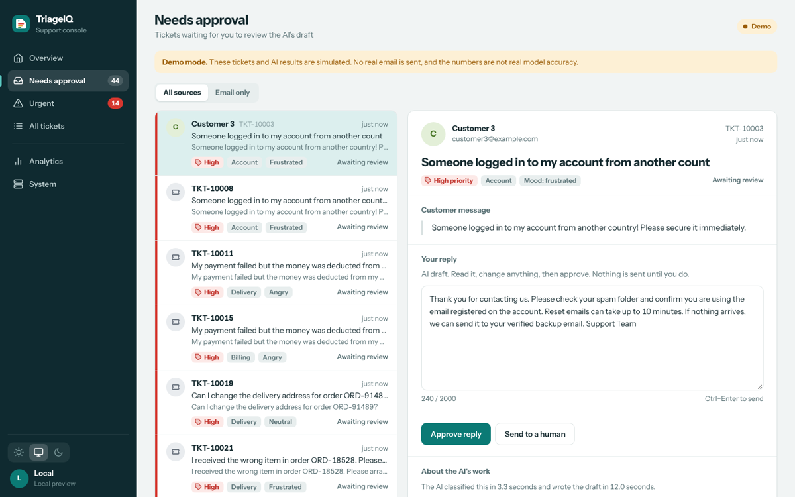 |
| **Overview.** How many tickets are waiting, split by priority, and how long the oldest has waited. | **Needs approval.** Each ticket shows its category, priority and mood, the customer's message and the AI's draft. |
| 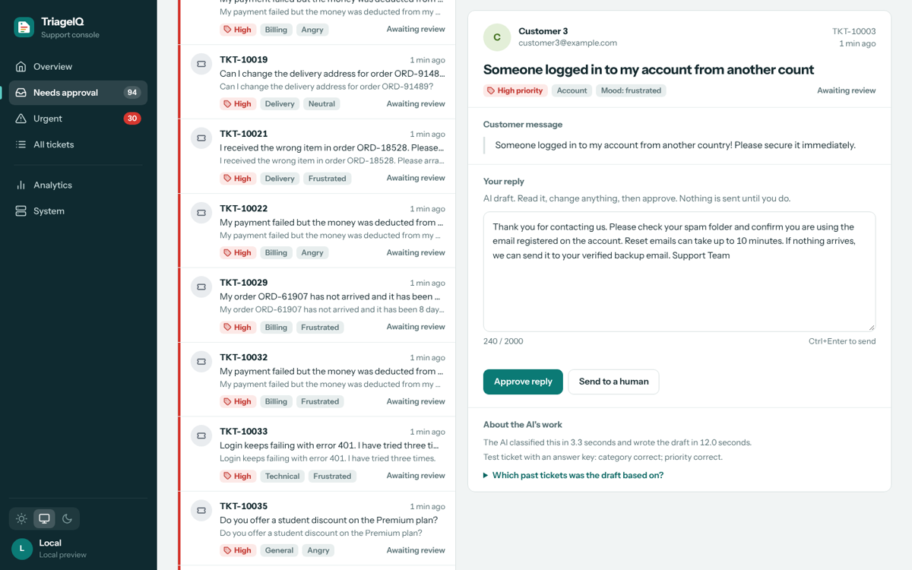 | 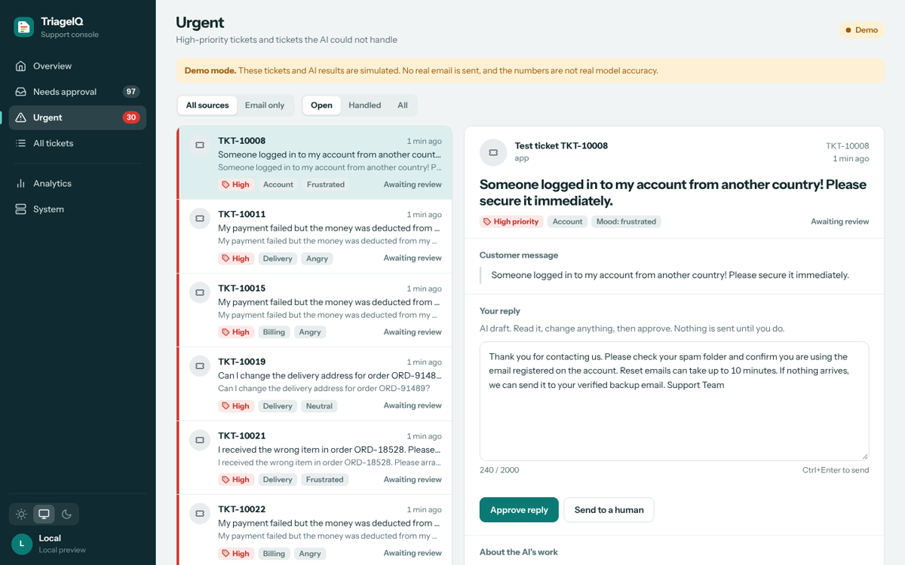 |
| **Ticket and draft.** Read it, change anything, then approve or send it to a human. Nothing is sent until you do. | **Urgent.** High-priority tickets, and the tickets the AI could not handle. |
| 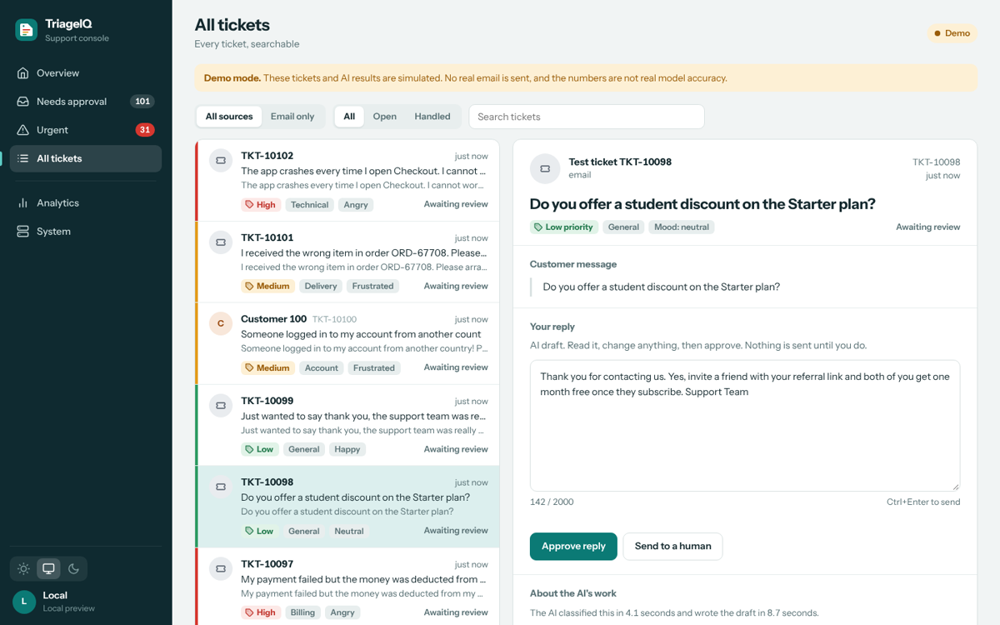 | 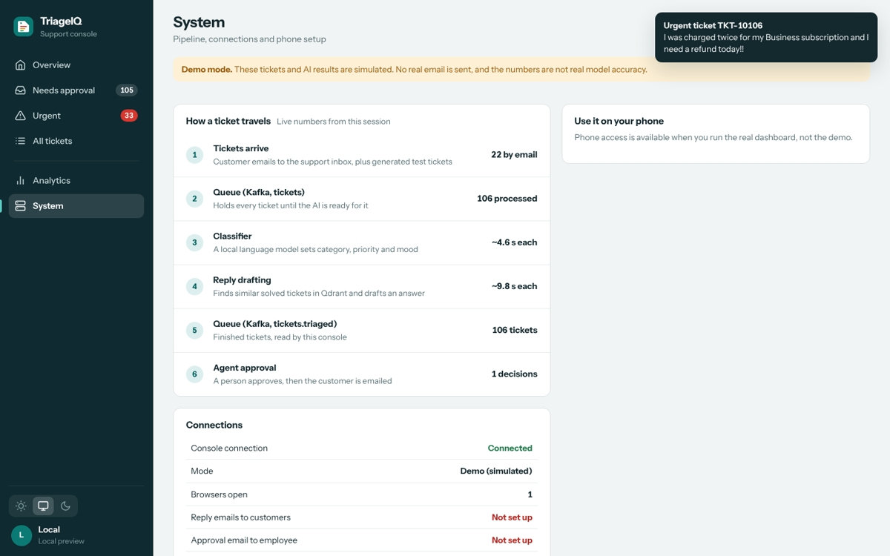 |
| **All tickets.** Every ticket, searchable and filterable by source and status. | **System.** How a ticket travels through the pipeline, with live counters for each stage. |

## 🧠 How it works

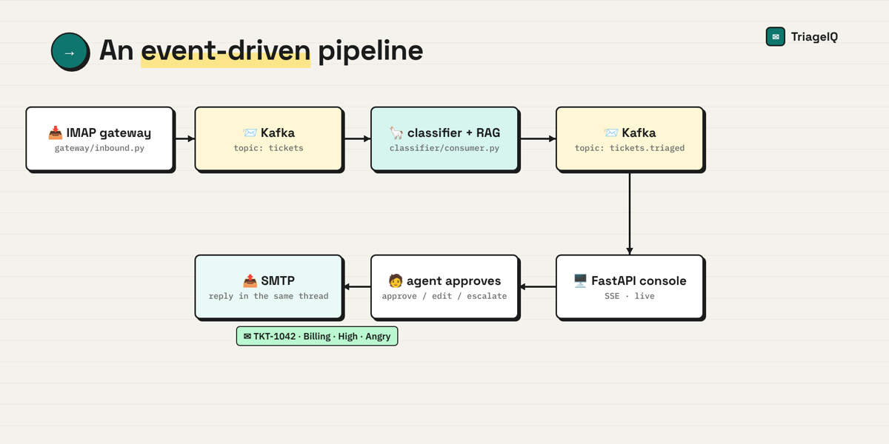

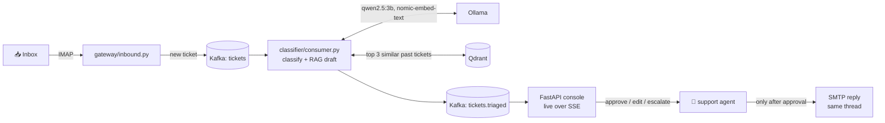

### Why Kafka in the middle

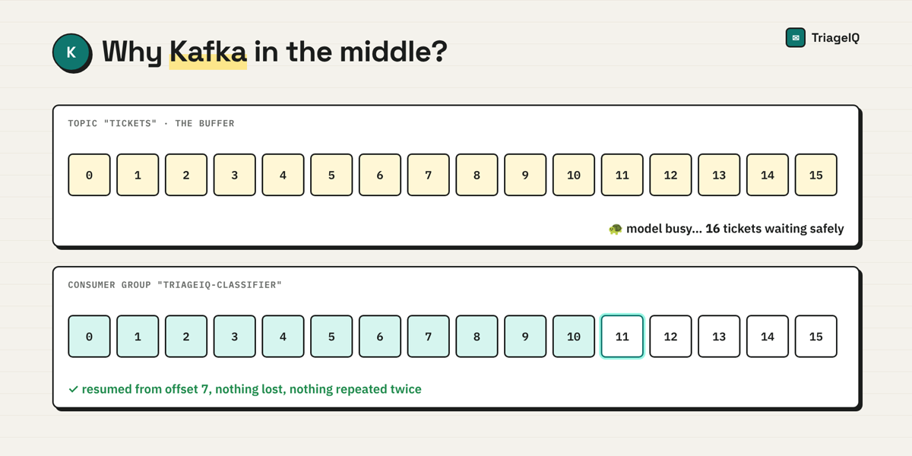

Kafka decouples reading email from running the model. If the model is slow, tickets wait safely in the `tickets` topic instead of being lost. The consumer group `triageiq-classifier` stores its offset, so after a restart it carries on from exactly where it stopped.

### Step 1: classify with a local LLM

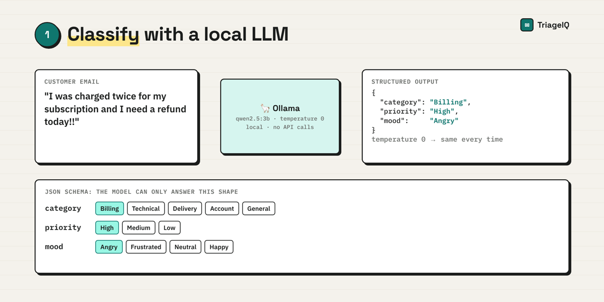

- The model is **Qwen 2.5 3B** (`qwen2.5:3b`) running locally in **Ollama**. Customer text never leaves the machine.
- The prompt defines every category and priority, and a **JSON schema** forces exactly three fields (`category`, `priority`, `mood`), each from a fixed list.
- **Temperature 0**, so the same email always gets the same answer.

### Never trust the model blindly

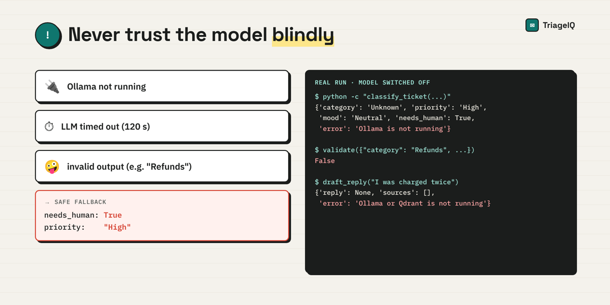

If Ollama is down, times out, or returns anything outside the allowed values, the ticket is **not dropped**. It falls back to `needs_human: True` with **High** priority, so a person looks at it first. The terminal on the right is a real run with the model switched off.

### Step 2: draft a reply with RAG

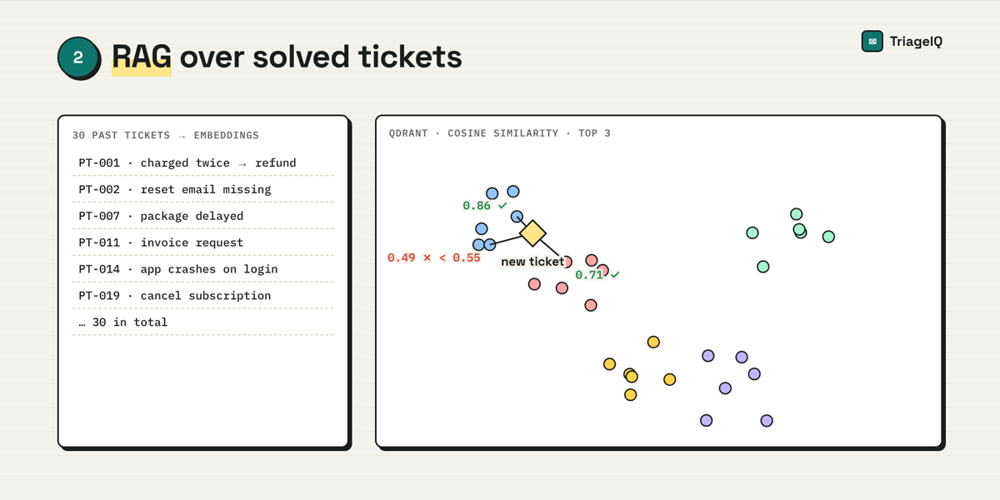

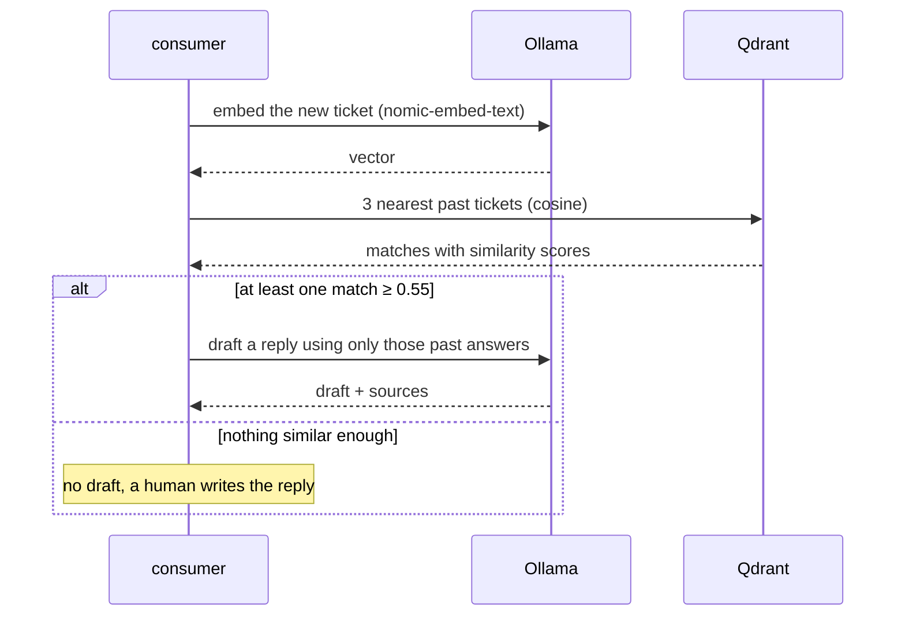

- 30 past tickets and how they were solved are embedded with `nomic-embed-text` and stored in Qdrant (`rag/ingest.py`).
- A new ticket is embedded the same way, and Qdrant returns the **top 3** by **cosine similarity**.
- Anything below **0.55** is ignored. If nothing is similar enough, there is no draft.

### Grounded replies

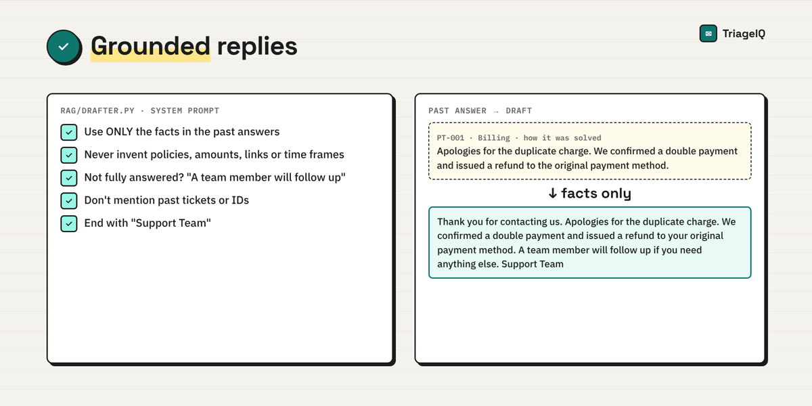

The drafting prompt says: use only the facts in the past answers; never invent policies, amounts, links or time frames; if they don't fully answer the customer, say a team member will follow up. The model writes the words, but the facts come from your own history. The console shows which past tickets each draft was based on.

### Step 3: a human stays in the loop

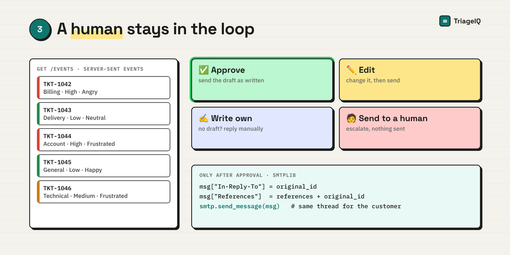

The console streams every ticket over **Server-Sent Events** (`/events`). The agent can **approve** the draft, **edit** it, **write their own**, or **send it to a human**. Only on approval does the reply go out over SMTP, in the same thread, using the `In-Reply-To` and `References` headers.

### Hardened for a real inbox

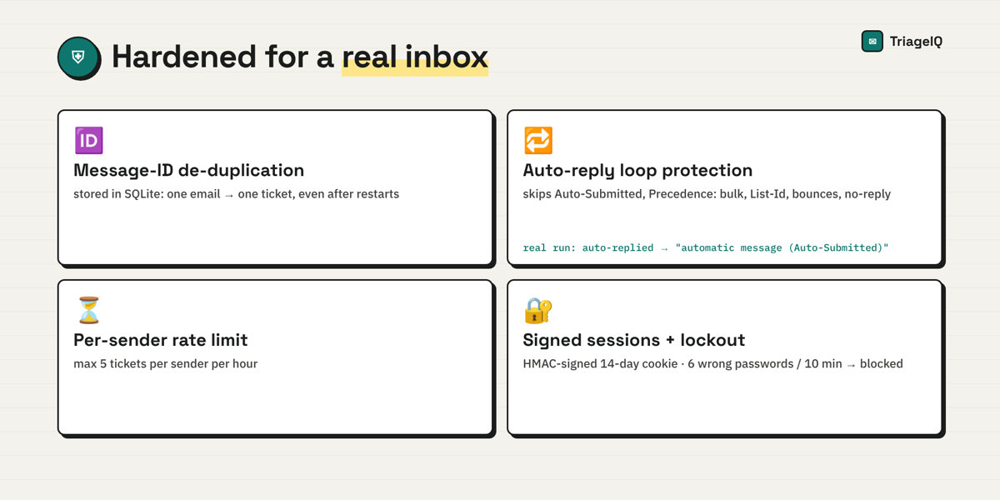

- **No duplicates:** every email's `Message-ID` is stored in SQLite, so one email is one ticket, even after restarts.
- **No reply loops:** auto-replies (`Auto-Submitted`), bulk mail (`Precedence: bulk`), mailing lists (`List-Id`), bounces and no-reply senders are skipped.
- **Rate limit:** one sender can create at most **5 tickets per hour** (`MAX_PER_SENDER_PER_HOUR`).
- **Sign-in:** an HMAC-signed 14-day session cookie, and a lockout after **6 wrong passwords in 10 minutes**.


## Project layout

```
TriageIQ/
  docker-compose.yml        Kafka and Qdrant
  producer/                 generates fake tickets for testing
  gateway/                  email in and out, settings, phone alerts
  classifier/               LLM classifier and the Kafka consumer
  rag/                      past tickets, Qdrant search, reply drafting
  dashboard/                FastAPI server, sign-in, console and app files
  .env.example              settings template (copy to .env)
```


## 🌐 Hosted demo

[](https://render.com/deploy?repo=https://github.com/HemashreeVI/TriageIQ)

`render.yaml` runs the console in demo mode with `TRIAGEIQ_HOSTED=1`: simulated tickets and AI results, no Kafka or local model needed, and it never reads `.env`, sends email or sends phone alerts. The real pipeline (IMAP, Kafka, Ollama, Qdrant) runs on your own machine, see Quick start.

## Quick start

**Requirements:** Docker Desktop, Python 3.11 or newer, [Ollama](https://ollama.com), and a Gmail account made just for the support inbox (with 2-Step Verification and an [app password](https://myaccount.google.com/apppasswords)).

```bash
# 1. install and start the services
python -m venv .venv
.venv\Scripts\activate            # Windows (on macOS/Linux: source .venv/bin/activate)
pip install -r requirements.txt
docker compose up -d

# 2. pull the local models
ollama pull qwen2.5:3b
ollama pull nomic-embed-text

# 3. create the Kafka topics (once)
docker exec kafka /opt/kafka/bin/kafka-topics.sh --create --topic tickets --bootstrap-server localhost:9092
docker exec kafka /opt/kafka/bin/kafka-topics.sh --create --topic tickets.triaged --bootstrap-server localhost:9092

# 4. load past tickets into the vector database (once)
python rag/ingest.py

# 5. settings
copy .env.example .env            # then fill in SUPPORT_EMAIL, SUPPORT_APP_PASSWORD, AGENT_EMAIL
python gateway/inbound.py --check # tests the Gmail login, sending and Kafka
```

Run each of these in its own terminal:

```bash
python gateway/inbound.py                       # turns new emails into tickets
python classifier/consumer.py --max 0           # classifies and drafts replies
python dashboard/server.py                      # the console at http://localhost:8050
```

The first start of the console prints a username and password and saves them in `.env`.

**Phone access:** install [`cloudflared`](https://developers.cloudflare.com/cloudflare-one/connections/connect-networks/downloads/) and the ntfy app, then start the console with:

```bash
python dashboard/server.py --share
```

It prints a secure `https://...trycloudflare.com` link. The address changes on every start, and it works only while your computer and TriageIQ are running.

**Try it without email or an LLM:** `python dashboard/server.py --demo` shows the console with simulated tickets. Demo data is fake, and nothing is ever sent.


## Honest limits

- The past-ticket knowledge base is **synthetic** (hand-written examples), so draft quality on real company data is untested.
- Accuracy numbers are **not measured yet.** The accuracy charts only use generated test tickets that come with an answer key.
- The phone link depends on a laptop staying on. A production setup would deploy the services to a server.
- It uses a small 3B-parameter local model, so it is fast and private but less accurate than a large hosted model.


## Roadmap

- [x] Kafka in Docker, ticket producer
- [x] LLM classifier (category, priority, mood) with safe fallback
- [x] RAG over past tickets and drafted replies
- [x] Agent console with live updates and approval
- [x] Real email in and out, with approval before sending
- [x] Employee alerts by email and phone push
- [x] Sign-in, themes, mobile layout, phone access
- [ ] Accuracy evaluation on 100+ labelled tickets, with prompt tuning
- [ ] Langfuse monitoring of LLM latency and errors
- [ ] Larger, more realistic knowledge base
- [ ] CI with GitHub Actions
- [x] Console screenshots in this README
- [x] How-it-works deep dive in this README
- [ ] Measured results and a demo video in this README

Measured accuracy, latency and cost per ticket will be added here once the evaluation is done.

<p align="center">
  
</p>
