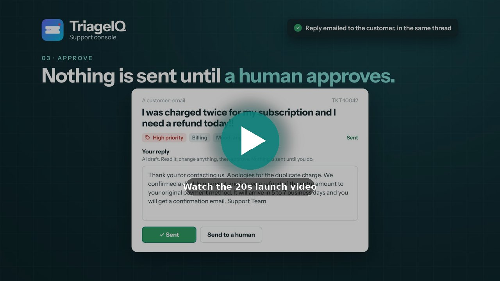
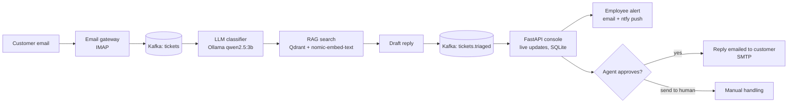
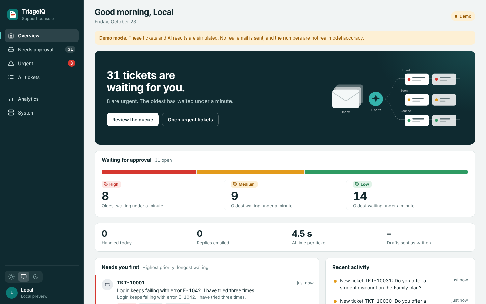
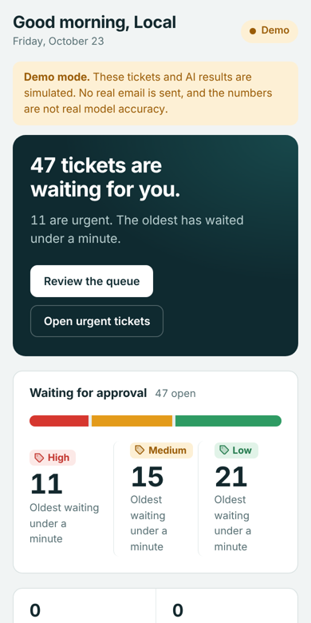

<p align="center">
  
</p>

<p align="center">
  
  
  
  
  
  
</p>

# TriageIQ

**TriageIQ reads customer support emails as they arrive, works out how urgent each one is, drafts a reply from the company's past resolved tickets, and asks a human agent to approve it. Only after approval is the reply emailed back to the customer.**

It runs fully on a laptop: the language model is local (Ollama), so no customer text is sent to an AI vendor.

<p align="center">
  <a href="docs/launch-video.mp4"></a>
  <br />
  <sub>▶ <a href="docs/launch-video.mp4"><b>Watch the 20-second launch video</b></a> (opens in GitHub's video player)</sub>
</p>

---

## The problem

Support teams receive thousands of messages an hour, for example:

> *"I was charged twice for my subscription and I need a refund today!!"*

Someone has to read each one, decide the category and urgency, and write a reply. It is slow, and urgent tickets get buried. TriageIQ does the first 80% of that work in seconds and keeps a person in charge of what is actually sent.

---

## What it does

1. **Customer emails the support inbox.** A gateway reads the Gmail inbox and turns each new email into a ticket.
2. **Kafka queues the ticket,** so a burst of emails waits in line instead of crashing anything.
3. **A local LLM classifies it:** category (Billing, Technical, Delivery, Account, General), priority (High, Medium, Low) and customer mood.
4. **RAG finds similar solved tickets** in a Qdrant vector database (matching by meaning, so "charged twice" finds "duplicate payment").
5. **The LLM drafts a reply** grounded in those past answers.
6. **The employee is alerted** by email and by a phone push notification.
7. **The agent reviews the draft in the console,** edits it, and approves.
8. **Only then is the reply emailed to the customer,** in the same email thread.

If the model fails or returns something invalid, the ticket goes to a human instead of getting lost.

---

## Architecture



<p align="center">
  
</p>

---

## The agent console

A web console for the support team: sign-in, light and dark themes, and a layout that works on a phone.

| Tab | Purpose |
|---|---|
| Overview | How many tickets are waiting, split by priority with the oldest wait, plus the tickets that need attention first |
| Needs approval | The queue of AI drafts waiting for a human |
| Urgent | High-priority tickets and tickets the AI could not handle |
| All tickets | Everything, searchable |
| Analytics | Volume, topics, AI response time, accuracy and a confusion matrix |
| System | How a ticket travels, connection status, and phone setup |

Keyboard shortcuts: `J` and `K` move through the list, `Ctrl+Enter` sends, `/` searches.

<p align="center">
  
  &nbsp;
  
</p>
<p align="center"><sub>The console in demo mode (<code>python dashboard/server.py --demo</code>), on a laptop and on a phone. Demo tickets are simulated.</sub></p>

### Using it from a phone

The console can be opened from anywhere through a free **Cloudflare quick tunnel**, protected by a login. **ntfy** sends a push notification to the phone when a new email ticket arrives. The notification carries only the ticket number, category and priority, never the customer's message.

---

## Safety design

- **Nothing reaches a customer without human approval.** The console asks for confirmation before sending, and a sent reply cannot be edited or sent twice.
- **Email loop protection:** auto-replies, bounces, mailing lists, `no-reply` senders and the company's own address are ignored.
- **No duplicates:** emails are de-duplicated by Message-ID, and an email is marked read only after Kafka has confirmed the ticket.
- **Rate limit per sender** to stop one address from flooding the queue.
- **Login:** signed, HttpOnly session cookie, a lockout after repeated wrong passwords, same-origin checks on every change, and strict security headers.
- **Secrets stay local:** `.env` is git-ignored, and the app creates the dashboard password and alert topic on first run.

---

## Tech stack

<p align="center">
  
  
  
  
  
  
  
  
  
  
  
  
  
  
  
</p>

| Tool | Role |
|---|---|
| Python | Every service: gateway, classifier, RAG, console server |
| Apache Kafka | Streams tickets between services |
| Ollama (`qwen2.5:3b`, `nomic-embed-text`) | Local LLM for classification and drafting, and text embeddings |
| Qdrant | Vector database for semantic search over past resolved tickets |
| FastAPI + Server-Sent Events | Console backend with live updates |
| SQLite | Agent decisions and email-gateway state |
| Docker Compose | Runs Kafka and Qdrant with one command |
| Gmail (IMAP / SMTP) | Receiving and sending real email |
| Cloudflare Tunnel | Secure public link to the console for phone access |
| ntfy | Free push notifications to the phone |
| Chart.js | Analytics charts |
| HTML, CSS, JavaScript | The console and sign-in page, with no front-end framework |
| Git and GitHub | Version control and hosting |

---

## Project layout

```
TriageIQ/
  docker-compose.yml        Kafka and Qdrant
  producer/                 generates fake tickets for testing
  gateway/                  email in and out, settings, phone alerts
  classifier/               LLM classifier and the Kafka consumer
  rag/                      past tickets, Qdrant search, reply drafting
  dashboard/                FastAPI server, sign-in, console and app files
  .env.example              settings template (copy to .env)
```

---

## Quick start

**Requirements:** Docker Desktop, Python 3.11 or newer, [Ollama](https://ollama.com), and a Gmail account made just for the support inbox (with 2-Step Verification and an [app password](https://myaccount.google.com/apppasswords)).

```bash
# 1. install and start the services
python -m venv .venv
.venv\Scripts\activate            # Windows (on macOS/Linux: source .venv/bin/activate)
pip install -r requirements.txt
docker compose up -d

# 2. pull the local models
ollama pull qwen2.5:3b
ollama pull nomic-embed-text

# 3. create the Kafka topics (once)
docker exec kafka /opt/kafka/bin/kafka-topics.sh --create --topic tickets --bootstrap-server localhost:9092
docker exec kafka /opt/kafka/bin/kafka-topics.sh --create --topic tickets.triaged --bootstrap-server localhost:9092

# 4. load past tickets into the vector database (once)
python rag/ingest.py

# 5. settings
copy .env.example .env            # then fill in SUPPORT_EMAIL, SUPPORT_APP_PASSWORD, AGENT_EMAIL
python gateway/inbound.py --check # tests the Gmail login, sending and Kafka
```

Run each of these in its own terminal:

```bash
python gateway/inbound.py                       # turns new emails into tickets
python classifier/consumer.py --max 0           # classifies and drafts replies
python dashboard/server.py                      # the console at http://localhost:8050
```

The first start of the console prints a username and password and saves them in `.env`.

**Phone access:** install [`cloudflared`](https://developers.cloudflare.com/cloudflare-one/connections/connect-networks/downloads/) and the ntfy app, then start the console with:

```bash
python dashboard/server.py --share
```

It prints a secure `https://...trycloudflare.com` link. The address changes on every start, and it works only while your computer and TriageIQ are running.

**Try it without email or an LLM:** `python dashboard/server.py --demo` shows the console with simulated tickets. Demo data is fake, and nothing is ever sent.

---

## Honest limits

- The past-ticket knowledge base is **synthetic** (hand-written examples), so draft quality on real company data is untested.
- Accuracy numbers are **not measured yet.** The accuracy charts only use generated test tickets that come with an answer key.
- The phone link depends on a laptop staying on. A production setup would deploy the services to a server.
- It uses a small 3B-parameter local model, so it is fast and private but less accurate than a large hosted model.

---

## Roadmap

- [x] Kafka in Docker, ticket producer
- [x] LLM classifier (category, priority, mood) with safe fallback
- [x] RAG over past tickets and drafted replies
- [x] Agent console with live updates and approval
- [x] Real email in and out, with approval before sending
- [x] Employee alerts by email and phone push
- [x] Sign-in, themes, mobile layout, phone access
- [ ] Accuracy evaluation on 100+ labelled tickets, with prompt tuning
- [ ] Langfuse monitoring of LLM latency and errors
- [ ] Larger, more realistic knowledge base
- [ ] CI with GitHub Actions
- [x] Console screenshots in this README
- [ ] Measured results and a demo video in this README

Measured accuracy, latency and cost per ticket will be added here once the evaluation is done.
