<p align="center">
  
</p>

<p align="center">
       
</p>














## Project layout

```
TriageIQ/
  docker-compose.yml        Kafka and Qdrant
  producer/                 generates fake tickets for testing
  gateway/                  email in and out, settings, phone alerts
  classifier/               LLM classifier and the Kafka consumer
  rag/                      past tickets, Qdrant search, reply drafting
  dashboard/                FastAPI server, sign-in, console and app files
  .env.example              settings template (copy to .env)
```


## Quick start

**Requirements:** Docker Desktop, Python 3.11 or newer, [Ollama](https://ollama.com), and a Gmail account made just for the support inbox (with 2-Step Verification and an [app password](https://myaccount.google.com/apppasswords)).

```bash
# 1. install and start the services
python -m venv .venv
.venv\Scripts\activate            # Windows (on macOS/Linux: source .venv/bin/activate)
pip install -r requirements.txt
docker compose up -d

# 2. pull the local models
ollama pull qwen2.5:3b
ollama pull nomic-embed-text

# 3. create the Kafka topics (once)
docker exec kafka /opt/kafka/bin/kafka-topics.sh --create --topic tickets --bootstrap-server localhost:9092
docker exec kafka /opt/kafka/bin/kafka-topics.sh --create --topic tickets.triaged --bootstrap-server localhost:9092

# 4. load past tickets into the vector database (once)
python rag/ingest.py

# 5. settings
copy .env.example .env            # then fill in SUPPORT_EMAIL, SUPPORT_APP_PASSWORD, AGENT_EMAIL
python gateway/inbound.py --check # tests the Gmail login, sending and Kafka
```

Run each of these in its own terminal:

```bash
python gateway/inbound.py                       # turns new emails into tickets
python classifier/consumer.py --max 0           # classifies and drafts replies
python dashboard/server.py                      # the console at http://localhost:8050
```

The first start of the console prints a username and password and saves them in `.env`.

**Phone access:** install [`cloudflared`](https://developers.cloudflare.com/cloudflare-one/connections/connect-networks/downloads/) and the ntfy app, then start the console with:

```bash
python dashboard/server.py --share
```

It prints a secure `https://...trycloudflare.com` link. The address changes on every start, and it works only while your computer and TriageIQ are running.

**Try it without email or an LLM:** `python dashboard/server.py --demo` shows the console with simulated tickets. Demo data is fake, and nothing is ever sent.


## Honest limits

- The past-ticket knowledge base is **synthetic** (hand-written examples), so draft quality on real company data is untested.
- Accuracy numbers are **not measured yet.** The accuracy charts only use generated test tickets that come with an answer key.
- The phone link depends on a laptop staying on. A production setup would deploy the services to a server.
- It uses a small 3B-parameter local model, so it is fast and private but less accurate than a large hosted model.


## Roadmap

- [x] Kafka in Docker, ticket producer
- [x] LLM classifier (category, priority, mood) with safe fallback
- [x] RAG over past tickets and drafted replies
- [x] Agent console with live updates and approval
- [x] Real email in and out, with approval before sending
- [x] Employee alerts by email and phone push
- [x] Sign-in, themes, mobile layout, phone access
- [ ] Accuracy evaluation on 100+ labelled tickets, with prompt tuning
- [ ] Langfuse monitoring of LLM latency and errors
- [ ] Larger, more realistic knowledge base
- [ ] CI with GitHub Actions
- [x] Console screenshots in this README
- [ ] Measured results and a demo video in this README

Measured accuracy, latency and cost per ticket will be added here once the evaluation is done.

<p align="center">
  
</p>
